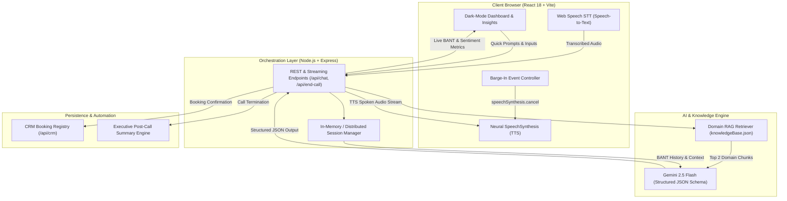

# Fortivex AI Technical Evaluation Report
**Candidate ID / Track:** `OC.44671.2027.65164` | Round 3 & Round 4 Evaluation  
**Project 1:** Autonomous AI Sales Voice Agent (**HelpingHand AI**)  
**Architecture:** Full-Stack (React 18 + Vite + Tailwind CSS | Node.js + Express + `@google/genai` Gemini 2.5 Flash)

---

### 1. Project Overview & Business Problem

Traditional B2B SaaS revenue operations suffer from acute inbound/outbound qualification bottlenecks:
- **Lead Latency & Drop-Off:** Inbound conversion rates collapse by 391% if leads are not engaged within 5 minutes; human Sales Development Reps (SDRs) average 42–120 minutes to respond.
- **High Labor Cost:** Scaling human SDR teams costs \$75,000–\$95,000/rep annually with high attrition (34%) and multi-month ramp cycles.
- **CRM Administrative Decay:** Reps waste 6–8 hours weekly on manual CRM updates, creating fragmented pipelines and inaccurate forecasting.

**HelpingHand AI** resolves these pain points through autonomous, zero-latency voice qualification. It engages leads in real time, handles complex SaaS objections using verified enterprise domain knowledge, qualifies prospects via the BANT framework, and injects booked meetings directly into CRM pipelines with zero administrative overhead.

---

### 2. System Architecture Diagram

---

### 3. Core End-to-End Workflow Implemented

1. **Multilingual Voice Loop & Barge-In:** Clicking "Start Call" triggers an opening greeting via neural TTS. Upon completion, STT automatically listens for prospect speech in English (`en-US`) or Hindi (`hi-IN`). If the user interrupts, speech synthesis cancels instantly.
2. **Context-Aware Objection Handling:** The RAG retriever evaluates prospect queries using keyword and semantic scoring against `knowledgeBase.json`, instantly handling contract lock-in, pricing, and SOC 2 security inquiries.
3. **Real-Time BANT & Sentiment Scoring:** Every turn updates the 0–100 lead score, tone classification, and dynamic BANT checkmarks.
4. **Automated Demo Booking:** Natural language calendar negotiations trigger structured booking payloads written directly to the CRM registry.
5. **Executive Post-Call Reporting:** Call termination invokes Gemini to synthesize an executive recap, pain points, objections, and next steps.

---

### 4. Scalability Strategy (Supporting up to 100,000 Users)

- **Stateless Application Tier:** Containerized Node.js/Express microservices auto-scaled horizontally behind AWS ALB / Cloudflare with WebSocket sticky sessions.
- **Distributed Session State:** Offload in-memory sessions to an ultra-low-latency Redis Cluster with TTL expiry and pub/sub synchronization.
- **Enterprise Vector Retrieval:** Upgrade local scoring to MongoDB Atlas Vector Search utilizing HNSW indexing with semantic query caching for sub-50ms retrieval.
- **Asynchronous Task Workers:** Decouple post-call summarization, CRM webhook ingestion, and calendar notifications using BullMQ / Apache Kafka.

---

### 5. Data Security, Deployment & Unit Economics

- **Security & Privacy:** Enforces TLS 1.3 in transit and AES-256 at rest. PII masking runs prior to LLM logging with a zero-retention enterprise AI guarantee.
- **Deployment:** Packaged via multi-stage Docker builds deployed on Google Cloud Run / AWS ECS Fargate with zero-downtime rolling updates.
- **Unit Economics:**
  - **AI Voice Agent:** ~\$0.025–\$0.038 per minute (Gemini 2.5 Flash tokens + STT/TTS compute).
  - **Human SDR Benchmark:** ~\$0.85–\$1.15 per active minute.
  - **Net Impact:** Yields ~80%–90% direct operational expenditure reduction while enabling 24/7 instantaneous pipeline generation.
